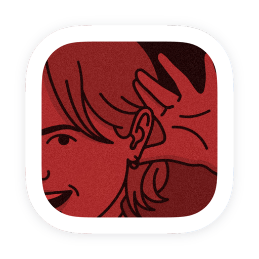

<p align="center">
  
</p>

<h1 align="center">Earwig</h1>

<p align="center">
  App desktop macOS per registrare audio (microfono + sistema) e trascriverlo <b>localmente</b> con NVIDIA Parakeet: nessun cloud, nessun account, nessun Docker.
</p>

## Cosa fa

- Registra **microfono** e **audio di sistema** contemporaneamente (es. una call) in un unico WAV
- Trascrive in italiano con **Parakeet TDT 0.6B v3** in-process (ONNX Runtime), nessun server esterno
- Distingue chi parla tra **Tu** (microfono) e **Altri** (sistema)
- Note, riassunti e chat sulle trascrizioni con un **LLM locale** (llama.cpp)
- Tray icon nella menu bar e avvio automatico opzionale in background

## Installazione

1. Scarica il DMG più recente da [GitHub Releases](https://github.com/vincenzo-mars/earwig/releases)
2. Apri il DMG e copia **Earwig** in `/Applications`
3. Da Terminale: `xattr -cr /Applications/Earwig.app`
4. Apri Earwig

Il passo 3 serve perché l'app non è notarizzata: da macOS Sequoia in poi il sistema la segnala come "danneggiata" al primo avvio. Il comando rimuove solo il flag di quarantena, non tocca nulla dell'app.

## Requisiti

- macOS 13 o superiore, Apple Silicon per il DMG rilasciato
- Permessi di sistema **Microfono** e **Registrazione schermo** (serve a ScreenCaptureKit per catturare l'audio di sistema: lo schermo non viene registrato, solo l'audio)
- Il modello STT viene scaricato al primo avvio

## Come si usa

Al primo avvio concedi i permessi richiesti e scarica il modello STT da **Impostazioni**.

- **REC** avvia e ferma la registrazione di mic e sistema insieme
- Dalla lista registrazioni apri il dettaglio e avvii la trascrizione, poi note, riassunti e chat

## Sviluppo

```bash
npm install
npm run tauri dev
```

Richiede i binari compilati in `src-tauri/binaries/` (vedi gli script in `scripts/`). Dettagli di build e architettura in [`docs/architecture.md`](docs/architecture.md).

## Documentazione

- [`docs/onboarding.md`](docs/onboarding.md): percorso di lettura del codice
- [`docs/architecture.md`](docs/architecture.md): flusso dati, pipeline audio, integrazione STT
- [`docs/reference.md`](docs/reference.md): comandi Tauri, tipi condivisi, componenti Svelte
